  

  
  
  
  
  

### What I do

I'm a civil engineer who builds AI tools for **ageing infrastructure**: turning drone footage,
LiDAR scans and engineering specs into something an engineer can actually act on.

### Co-founder of [CorrSens](https://www.corrsens.com)

Structural audits, NDT testing and corrosion protection for critical infrastructure, developed at IIT Madras.

- **Bridgescan** turns bridge point clouds into reviewable BIM elements
- **InfraTWIN** is a digital-twin platform for inspection data

### Journey

| | Where | What |
|---|---|---|
| **now** | Indian School of Business, Hyderabad | IVI program |
| **before** | IIT Madras | Computer vision research |
| **start** | NIT Calicut | B.Tech |

### Featured projects

| Project | What it is |
|---|---|
| **[nrjNET](https://github.com/nrjai/nrjNET)** | My first neural network, built **from scratch** in pure Python. Autograd, backprop and an MLP, with gradients verified against PyTorch. |
| **[Civion](https://github.com/nrjai/Civion)** | A compliance engine for IS 456:2000 concrete specs. Upload a spec PDF, get an audit, chat about it and generate a corrected version. |
| **[Gaussian Splatting Demo](https://github.com/nrjai/Gaussian_splatting_demo)** | Gaussian splatting, a new kind of 3D modelling, applied to a bridge in Kerala |
| **[Construction Object Detection](https://github.com/nrjai/Construction-object-detection---YOLO)** | YOLOv8 material detection for construction progress monitoring |

### Toolbox

  

**Also:** YOLOv8 · point clouds (LAS) · BIM / IFC · photogrammetry · Gaussian splatting

### Currently learning

Deep learning **from first principles**: building every piece by hand before using the frameworks.
Started with [nrjNET](https://github.com/nrjai/nrjNET).

turning visual data into engineering intelligence

